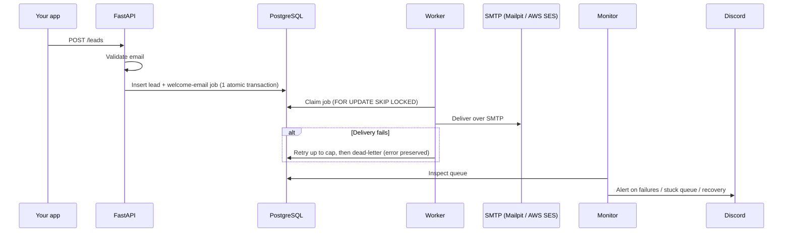
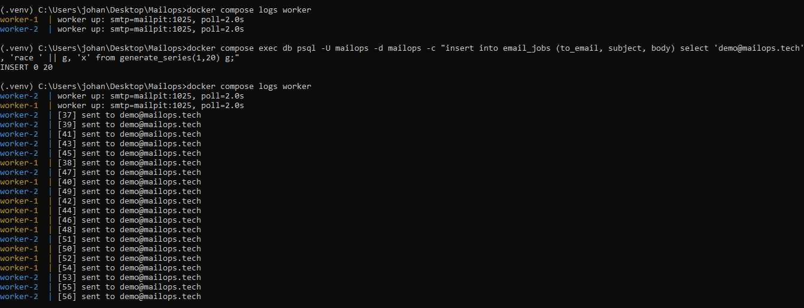
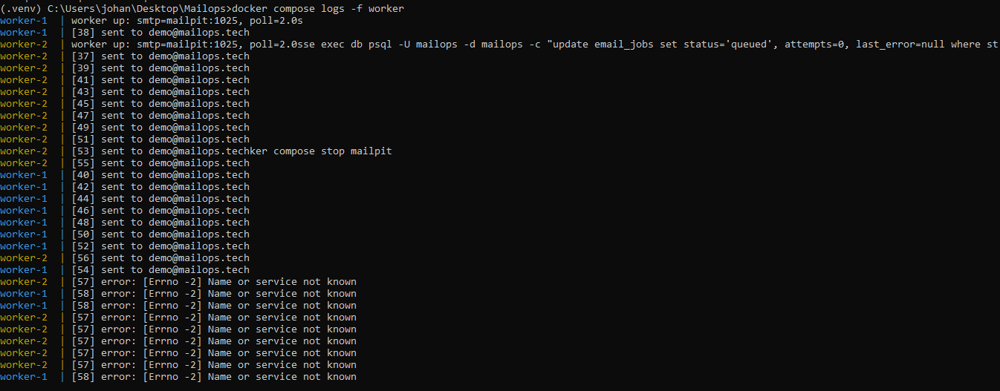
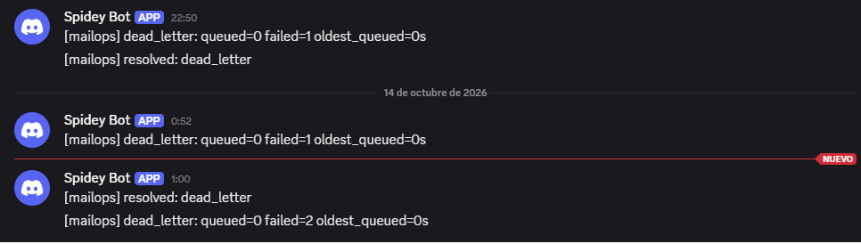

<div align="center">

# Mailops

**Manage, send, and monitor your company's email — securely, from one place.**

[](https://github.com/jayfelipe/mailops/actions/workflows/ci.yml)


[Features](#-features) · [How it works](#-how-it-works) · [Quickstart](#-quickstart) · [Reliability](#-reliability-demonstrated) · [Operations](#-operations) · [Roadmap](#-roadmap)

</div>

---

## Overview

A business wants to email its customers, keep track of potential buyers, and make sure messages **actually arrive** — not bounce, not land in spam.

**mailops** brings all of that into a single system that runs with one command: domain deliverability checks, a lightweight CRM, a reliable delivery queue, and proactive monitoring with alerts.

```bash
docker compose up -d
```

## Features

### Deliverability checks
Before anything is sent, mailops verifies that your domain is configured so messages don't get rejected or flagged as spam.

| Protocol | What it does |
|----------|--------------|
| **SPF**   | Declares which servers are allowed to send on behalf of the domain |
| **DKIM**  | Signs messages so receivers can verify they're authentic |
| **DMARC** | Tells receivers what to do when those checks fail |

```bash
mailops github.com
```

The tool reports what's wrong **and how to fix it**. For example, it found two live 1024-bit signing keys on `github.com`.

### Lead management (mini CRM)
Register a person's name, email, and status. Every new lead automatically triggers a welcome email through the delivery queue.

### Monitoring and alerting
A monitor runs on a cycle over the queue and the infrastructure:

- Detects **dead-lettered** mail (deliveries that failed after all retries)
- Flags **stuck queues**
- Sends **Discord alerts** when something breaks, and a **resolution notice** when it recovers

### 🛠 Automated, documented operations
- **Docker Compose** — the whole stack runs containerized
- **GitHub Actions** — lint + tests on every push
- **Runbooks** — repeatable procedures for common incidents
- **Incident log** — every failure diagnosed and documented

## How it works

Say someone signs up on your site:



1. Your app calls `POST /leads` — the API **validates the email**.
2. The lead and the welcome-email job are stored in PostgreSQL in **one atomic transaction**: either both exist, or neither does.
3. The worker picks the job from the queue and **delivers it over SMTP**.
4. If delivery fails, the job **retries up to a cap**, then **dead-letters** with the error preserved for investigation.
5. The monitor notices failures and **alerts you before the customer notices**.

> **Pluggable transport.** This repo ships with [Mailpit](https://mailpit.axllent.org/), a local, dev-safe SMTP sink with a web UI. Pointing it at **AWS SES** for production is a **config change, not a code change**.

## 🧱 Stack

| Technology | Role |
|------------|------|
| **Python / FastAPI** | API: lead intake, health probe |
| **PostgreSQL** | Data + job queue (`FOR UPDATE SKIP LOCKED`) |
| **Worker** | SMTP delivery with bounded retries and dead-lettering |
| **Mailpit / AWS SES** | Local SMTP sink / production transport |
| **Docker Compose** | Everything containerized, one command up |
| **GitHub Actions** | CI: `ruff` + `pytest` on every push |
| **Discord webhooks** | Alerting |

## 🚀 Quickstart

```bash
# 1. Start the full stack
docker compose up -d
#    → API on        http://localhost:8000
#    → Mailpit UI on http://localhost:8025

# 2. Install the CLI
pip install -e ".[dev]"

# 3. Audit a domain
mailops github.com
```

### Create a lead

```bash
curl -X POST http://localhost:8000/leads \
  -H "Content-Type: application/json" \
  -d '{"name": "Ada Lovelace", "email": "ada@example.com", "status": "new"}'
```

Open the Mailpit UI at `http://localhost:8025` to see the welcome email arrive.

## 🛡 Reliability, demonstrated

**No duplicates, no coordination.** Two workers drain the same queue with nothing but the database to coordinate them:



**Nothing is lost.** Kill the SMTP sink mid-flight: the job retries, the failure is recorded, and the message is delivered once the sink is back:



**You find out first.** Dead letters alert to Discord, and a resolution notice is sent when they're cleaned up:



## Operations

-  **[Incident log](docs/incidents.md)** — 4 documented incidents:
  - A DER-walk bug
  - A native Postgres answering on the wrong port
  - Crash recovery masquerading as unhealthiness
  - A webhook blocked by User-Agent filtering
-  **[Runbooks](docs/runbooks/)** — e.g. requeueing dead-lettered jobs

##  Roadmap

Known limitations and planned upgrades for **v0.2**:

- [ ] **Exponential backoff** — retries currently use a fixed 2s interval
- [ ] **Header-based DKIM selector extraction** — discovery is currently probe-based
- [ ] **Connection pooling** — one DB connection per request today; move to `psycopg_pool` when it hurts

##  Contributing

Contributions are welcome. Before opening a PR, make sure lint and tests pass:

```bash
ruff check .
pytest
```

##  License

Released under the [MIT License](LICENSE).

---

<div align="center">
<sub>Built so you hear about delivery problems before your customers do.</sub>
</div>